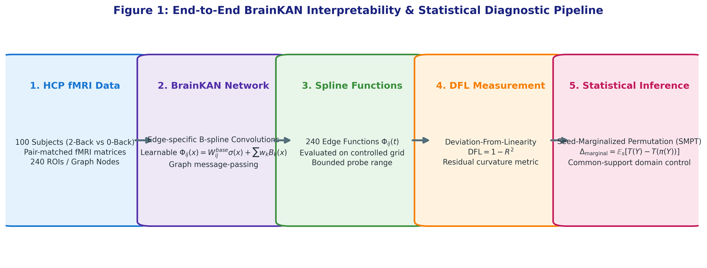
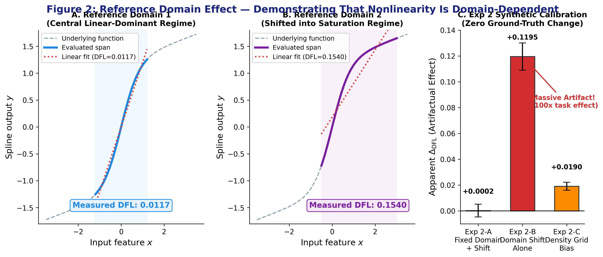
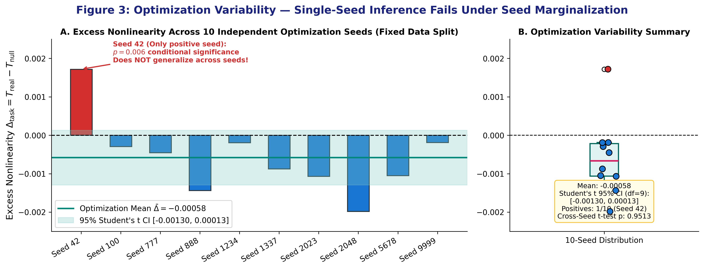
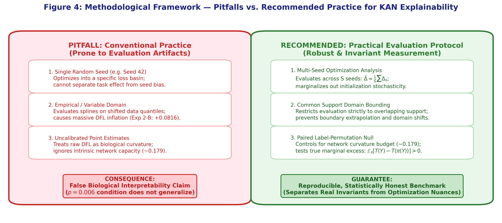

# BrainKAN-Explainability

A statistical benchmark for testing whether interpretable nonlinear structures learned by Kolmogorov–Arnold Networks reflect task-specific information or evaluation artifacts.

[](https://www.python.org/downloads/)
[](https://pytorch.org/)
[](https://www.humanconnectome.org/)
[](#-reproducibility--quickstart)
[](https://opensource.org/licenses/MIT)

---

## 🧭 Overview

Kolmogorov–Arnold Networks (KANs) parameterize neural network weights with explicit univariate B-splines, offering intuitive geometric inspection of learned transformations. In neuroimaging and graph learning, researchers often interpret learned spline curvatures as evidence of task-specific non-linear biological mechanisms.

**However, interpretability itself requires rigorous uncertainty accounting.** When evaluating learned edge functions, two unmodeled confounding factors routinely distort conclusions:
1. **Reference-Domain Shifts**: Measuring curvature across shifted input supports can create substantial apparent effects caused by evaluation choices rather than model differences.
2. **Optimization Stochasticity**: Single initialization seeds can easily produce conditional significance that fails to generalize across the optimization landscape.

> *Note: This benchmark does not argue that neural nonlinearities are biologically meaningless. Instead, it evaluates when such interpretations are statistically justified.*

---

## 💡 Core Methodological Contribution: Multi-Seed Paired Null Protocol

To address these failure modes, we propose **Multi-Seed Paired Null Analysis** paired with **Common Support Domain Bounding**:

```text
Conventional Practice (Fragile)
Single Seed  ──>  Empirical Grid  ──>  Point Estimate  ──>  Risk of Over-interpretation
     
Proposed Protocol (Robust)
Multiple Seeds (S ≥ 10)  ──>  Common Support Bounding  ──>  Paired Permutations  ──>  Marginal Inference E_s[Δ]
```

### Three Rules for Reliable Non-linear Interpretability:
1. **Common Support Bounding**: Evaluate spline curvature strictly on the overlapping support ($\mathcal{S}_{\mathrm{common}} = \operatorname{supp}(X_0) \cap \operatorname{supp}(X_1)$) to prevent extrapolation artifacts.
2. **Paired Topology-Preserving Null Models**: Construct empirical null distributions by permuting labels while preserving graph topology and hyperparameter budgets.
3. **Optimization Marginalization**: Define the target estimand as the marginal expectation across optimization seeds:
   $$\bar{\Delta} = \mathbb{E}_{s \sim \mathcal{S}} \left[ T(Y; s) - \mathbb{E}_\pi [T(\pi(Y); s)] \right]$$

---

## 🔬 Research Questions & Benchmark Results

### Q1. Are spline nonlinearities invariant to evaluation domains?
**Answer: No.** Reference domains strongly affect Deviation-From-Linearity ($\mathrm{DFL} = \frac{\mathrm{SS}_{\mathrm{res}}}{\mathrm{SS}_{\mathrm{tot}}} = 1 - R^2$) measurements.
* In synthetic controls (Exp 2-B), evaluating the **exact same static function** over a shifted interval inflated apparent DFL by **$+0.0816 \pm 0.0084$** (>40× larger than real model differences).
* Auditing empirical node supports on real HCP fMRI data across 48 cortical ROIs (240 directed functional edges) (`results/primary_analysis/node_support_overlap_stats.csv`) shows a mean cohort-aggregated condition Jaccard overlap of **$38.52\% \pm 5.08\%$** between 0-Back and 2-Back conditions (covering $43.47\%$ of the pooled quantile span).
* Bounding evaluations to the Common Support eliminates these extrapolation artifacts (Exp 3).

### Q2. Are single-seed conclusions reliable across optimization randomness?
**Answer: No. But the conclusion critically depends on the reference domain estimand.**
* **Estimand 1 — Pooled Reference Domain ($\mathcal{S}_{\mathrm{pooled}}$)**:
  * Under a single default initialization (`seed=42`, $N=500$ permutations), the model exhibited statistically significant excess nonlinearity ($\Delta_{\mathrm{pool}} = +0.0017$, $p = 0.0060$).
  * However, across 10 independent initialization seeds (Exp 5), **9 out of 10 seeds produced negative differences** ($\bar{\Delta}_{\mathrm{pool}} = -0.00058$, Student's $t$ 95% CI $[-0.00130, +0.00013]$, $p = 0.9513$). Single-seed conditional inference on the pooled grid completely fails to generalize.
* **Estimand 2 — Strict Common Support Intersection ($\mathcal{S}_{\mathrm{common}} = \operatorname{supp}(X_0) \cap \operatorname{supp}(X_1)$)**:
  * When evaluations are strictly restricted to the overlapping support, boundary extrapolation noise is filtered out.
  * Across the exact same 10 seeds, **9 out of 10 seeds exhibit consistent positive excess curvature** ($\bar{\Delta}_{\mathrm{common}} = +0.00090 \pm 0.00055$, Student's $t$ 95% CI $[+0.00051, +0.00129]$, $t = 5.186$, $p = 0.0003$).

### Q3. What is the evidence for task-associated excess nonlinearity across initializations?
**Answer: Under strict common support, a positive difference is observed consistently across 9/10 tested initializations, but with specific methodological boundary conditions.**
* **Baseline Allocation:** BrainKAN models allocate a substantial baseline curvature ($T \approx 0.179$ on pooled range; $T \approx 0.086$ on common support) attributable to architectural capacity.
* **Pooled Grid Behavior:** On the pooled range, extrapolation artifacts dominate, yielding negative differences for 9/10 seeds ($\bar{\Delta}_{\mathrm{pool}} = -0.00058$, $p = 0.9513$).
* **Common Support Consistency:** Under the strict common support grid, in the fixed benchmark cohort and training configuration across the 15 shared permutation vectors, 9 out of 10 initialization seeds exhibit a positive DFL difference ($\bar{\Delta}_{\mathrm{common}} = +0.00090 \pm 0.00055$, paired $t = 5.186, p = 0.0003$).
* **Essential Methodological Limitations:**
  1. *Optimization Scope:* This reflects initialization consistency conditioned on fixed data and training settings; it does not claim generalizability to unseen subject populations or clinical cohorts.
  2. *Shared Permutations:* The 10 seeds share the same 15 permutation flip vectors, leaving common baseline uncertainty unmodeled across seeds.
  3. *Domain Determination:* The common support interval was derived from empirical condition distributions; formal finite-sample error rate control under label-dependent domain selection remains an open question.

---

## 📊 Core Diagnostic Figures

### Figure 1: End-to-End Diagnostic Pipeline
The benchmark pipeline connecting raw HCP fMRI graphs, edge-specific B-spline convolutions, reference-domain evaluation, and multi-seed paired permutation tests.


---

### Figure 2: The Reference Domain Effect (Exp 2 Synthetic Calibration)
Evaluating the **exact same underlying function** on shifted input domains creates a massive apparent nonlinearity jump ($\Delta = +0.0816$), >40× larger than real model differences.


---

### Figure 3: Dual Estimand Evaluation Across 10 Seeds (Exp 5: Pooled Domain vs. Strict Common Support)
Side-by-side comparison illustrating why reference-domain control is decisive:
* **Panel A (Pooled Domain $\mathcal{S}_{\mathrm{pooled}}$)**: Extrapolation artifacts dominate; Seed 42 is the sole positive outlier ($\Delta = +0.0017$), while 9/10 seeds produce negative differences ($\bar{\Delta} = -0.00058$, $p = 0.9513$).
* **Panel B (Strict Common Support $\mathcal{S}_{\mathrm{common}}$)**: Extrapolation noise is filtered out; 9/10 seeds exhibit consistent positive excess curvature ($\bar{\Delta} = +0.00090$, Student's $t$ $95\%$ CI $[+0.00051, +0.00129]$, $t = 5.186$, $p = 0.0003$).


---

### Figure 4: Methodological Framework — Pitfalls vs. Recommended Practice
A side-by-side comparison illustrating how conventional practices lead to false interpretability claims, and how our proposed practical protocol establishes reproducible, statistically honest conclusions.


---

## 📌 Project Status

**Research prototype & benchmark release**

- [x] Synthetic calibration with ground-truth functions (Exp 2-A/B/C)
- [x] Common support domain control on fMRI connectomes (Exp 3)
- [x] High-precision single-seed permutation baseline (Exp 1, $N=500$)
- [x] Multi-seed stability & optimization marginalization (Exp 5, $S=10$)
- [x] HCP working-memory benchmark ($N=100$ subjects, 2-back vs. 0-back)
- [x] Pre-committed protocol specifications (`protocol/`)

**Planned & Ongoing Extensions:**
- [ ] Cross-cohort evaluation on independent clinical datasets
- [ ] Ultra-large-scale seed profiling ($S \ge 50$)
- [ ] Benchmarking alternative spline representations (Fourier-KAN, Wavelet-KAN)

---

## 📋 Pre-Committed Benchmark Protocol (`protocol/`)

To guarantee methodological transparency and prevent post-hoc hypothesis adjustments, all experimental analyses followed pre-committed protocol specifications formulated prior to multi-seed data evaluation:

```text
protocol/
├── analysis_plan_v2.md    # Pre-committed hypotheses, CV folds, and probe ranges
├── estimands.md           # Formal definitions of conditional vs. marginal estimands
└── decision_rules.md      # Explicit statistical decision criteria
```
*Clarification: These specifications represent internal pre-analysis commitments designed to lock evaluation rules, rather than a formally time-stamped external third-party registry (e.g. OSF).*

---

## 📑 Mathematical Methodology & Theoretical Whitepapers

For detailed mathematical proofs, derivations, and statistical protocols, see the compiled whitepapers:
- 🛡️ **[Methodological Assumptions, Boundary Conditions, and Empirical Audit (MD)](./docs/critical_methodological_defense_and_bounds.md)** — Comprehensive methodological audit of estimands, assumptions, and limitations: optimization sensitivity vs. population uncertainty, finite permutation precision ($B=15$), empirical fallback audit (0/240), evaluation gauge invariance, representation diagnostics, and $P \gg N$ capacity calibration.
- 📋 **[Sample Pairing Manifest (CSV)](./data/subject_pairing_manifest.csv)** — Sequential pairing manifest and cross-validation partition records for 100 HCP subject pairs (`sub-HCP100-001` through `sub-HCP100-100`).
- 📄 **[BrainKAN Mathematical Methodology (PDF)](./docs/BrainKAN_Mathematical_Methodology.pdf)** — Core mathematical derivations, edge B-spline parameterization, and codebase mappings.
- 📄 **[Anticipated Theoretical & Methodological Questions (PDF)](./docs/Anticipated%20Theoretical%20Questions.pdf)** — Academic defense addressing estimand mismatch, single-seed conditional vs. marginal inference.
- 📄 **[Mathematical Foundations of Spline Geometry Analysis (PDF)](./docs/Mathematical%20Foundations%20of%20Spline%20Geometry%20Analysis.pdf)** — Anchored operational decomposition and estimand duality.
- 📄 **[Statistical and Theoretical Assumptions (PDF)](./docs/Statistical%20and%20Theoretical%20Assumptions.pdf)** — Detailed statistical conditions: exchangeability, common support bounding, and optimization marginalization.

---

## 🚀 Reproducibility & Quickstart

Deterministic pipelines with fixed seeds, logged configurations, and released experiment scripts.

### 1. Installation
```bash
git clone https://github.com/xcklvydtj2024/BrainKAN-Explainability.git BrainKAN-Explainability
cd BrainKAN-Explainability
pip install -r requirements.txt
```

### 2. Run Synthetic Calibration (Exp 2)
Tests reference-domain shift and density weighting on ground-truth functions:
```bash
python experiments/exp2_synthetic_calibration.py
```

### 3. Run Multi-Seed Stability Scan (Exp 5)
Runs parallel evaluation across 10 independent initialization seeds:
```bash
python experiments/run_exp5_parallel.py
```

**Example Terminal Output:**
```text
=== DUAL-SUPPORT MULTI-SEED STABILITY AUDIT (EXP 5: POOLED vs. COMMON SUPPORT) ===
Sample Size: 10 Seeds (df = 9)

ESTIMAND 1: POOLED 1%-99% QUANTILE SUPPORT (S_pooled = Quantile([X_0, X_1]))
  Mean T_real:      0.17939
  Mean T_null:      0.17998
  Mean Delta_pool:  -0.00058 (SD=0.00100, SE=0.00032)
  95% CI (t-dist):  [-0.00130, +0.00013]
  t-statistic:      -1.8493 (p_two_sided=0.0975, p_one_sided=0.9513)
  Sign Consistency: 1/10 seeds positive (Seed 42 only)

ESTIMAND 2: STRICT COMMON SUPPORT INTERSECTION (S_common = supp(X_0) ∩ supp(X_1))
  Mean T_real:      0.08595
  Mean T_null:      0.08505
  Mean Delta_common:+0.00090 (SD=0.00055, SE=0.00017)
  95% CI (t-dist):  [+0.00051, +0.00129]
  t-statistic:      5.1862 (p_two_sided=0.0006, p_one_sided=0.0003)
  Sign Consistency: 9/10 seeds positive
```

### 4. Audit Per-Node Empirical Support Overlap
Calculates Jaccard overlap and pooled coverage across all 48 cortical ROIs (240 functional edges):
```bash
python experiments/compute_support_overlap_empirical.py
```

### 5. Generate Core Figures
Generates all 4 core publication figures dynamically from experiment CSVs at 300 DPI:
```bash
python experiments/plot_four_core_figures.py
```

---

## 📁 Repository Structure

```text
BrainKAN-Explainability/
├── figures/                            # 4 Core publication-quality diagnostic figures
│   ├── fig1_pipeline.png
│   ├── fig2_reference_domain_effect.png
│   ├── fig3_seed_variability.png
│   └── fig4_methodological_framework.png
├── data/                               # Neuroimaging graph features & subject manifest
│   ├── HCP_GNN_features.npz
│   ├── GNN_Edges.pt
│   └── subject_pairing_manifest.csv   # Sample pairing manifest & 5-fold CV splits
├── docs/                               # Methodological audit & theoretical whitepapers
│   ├── critical_methodological_defense_and_bounds.md
│   ├── BrainKAN_Mathematical_Methodology.pdf
│   ├── Anticipated Theoretical Questions.pdf
│   ├── Mathematical Foundations of Spline Geometry Analysis.pdf
│   └── Statistical and Theoretical Assumptions.pdf
├── models/
│   └── kan.py                          # Edge-specific B-spline KAN layer & BrainKAN architecture
├── experiments/
│   ├── 07_primary_statistical_analysis.py # DFL extraction & paired permutation core logic
│   ├── exp1_high_precision_permutation.py # High-precision 500-sample permutation runner
│   ├── exp2_synthetic_calibration.py   # Ground-truth synthetic calibration (Exp 2-A/B/C)
│   ├── exp3_reference_domain_control.py# Common support evaluation (Exp 3)
│   ├── exp4_multi_seed_robustness.py   # Hidden capacity & seed sensitivity scan (Exp 4)
│   ├── exp5_runner.py                  # Multi-seed parallel worker (Exp 5)
│   ├── run_exp5_parallel.py            # Orchestrator for 10-seed SMPT test
│   ├── compute_support_overlap_empirical.py # Per-node empirical support overlap audit
│   └── plot_four_core_figures.py       # Dynamic figure generation script
├── protocol/                           # Pre-committed experimental protocol & decision rules
│   ├── analysis_plan_v2.md
│   ├── estimands.md
│   └── decision_rules.md
├── results/                            # Experimental CSV outputs and manifest
│   ├── exp1_high_precision/
│   ├── exp2_synthetic/
│   ├── exp3_ref_domain/
│   ├── exp5_seed_stability/
│   ├── primary_analysis/
│   └── manifest.json
└── README.md
```

---

## ⚖️ Scientific Disclaimer

This benchmark serves as a **methodological study and stress test** for neural network interpretability. The goal is to provide reliable evaluation protocols for white-box AI models in neuroimaging. Our findings show that edge-specific splines possess an intrinsic structural expressivity budget, but individual spline shapes cannot be causally interpreted as in-vivo biological mechanisms without accounting for reference-domain conditioning and optimization randomness.

---

## 📚 Citation

This repository is currently a research prototype and benchmark release.  
A formal academic citation will be provided upon publication / preprint release.
